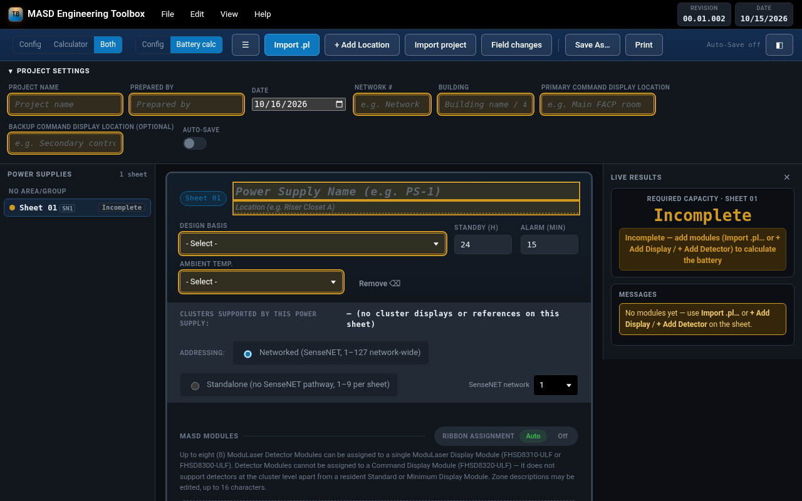
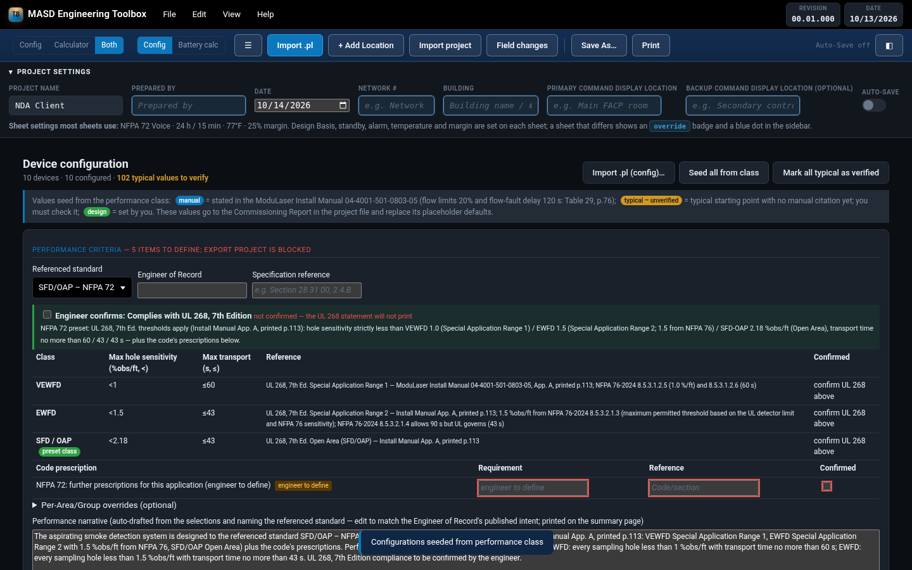

# MASD Engineering Toolbox




Offline engineering toolbox for **Edwards ModuLaser Modular Aspirating Smoke Detector (MASD)** projects.
It absorbs the **ModuLaser Battery Calculator** and adds device configuration, legacy-file migration and
the field-change approval loop with the **ModuLaser MASD Field (Commissioning) Report**.

- **Web / PWA (live):** https://thebmgatkgs.github.io/MASD-Engineering-Toolbox/ — open in a browser, or install it (Chrome/Edge install icon; iPhone/iPad Safari → Share → Add to Home Screen). Works offline after the first visit.
- **Windows installer:** [MASD-Engineering-Toolbox-Setup-00.03.000.exe](https://github.com/theBMGatKGS/MASD-Engineering-Toolbox/releases/download/v00.03.000/MASD-Engineering-Toolbox-Setup-00.03.000.exe) — pre-release [v00.03.000](https://github.com/theBMGatKGS/MASD-Engineering-Toolbox/releases/tag/v00.03.000) (x64 NSIS, unsigned; SmartScreen may prompt). SHA-256 `0e52dbca1fdf7c98fb4a0d32a9717e52a9db7d0215ce5fa577a5e4ec642686c9`.

> **Version 00.03.001_261019 — pre-release, local build (latest release: 00.03.000, 2026-10-19).** 01.00.000 is reserved for the refined first release.
> Calculation engine: **MASD engine 1.2.0** · Project file: **modulaser-project 1.6.0 (`.mlproj.json`)** ·
> Calculator lineage: **Battery Calculator 02.02.001**

### What's new in 00.03.001 (pre-release, local build, not released)

Harmonized with Battery Calculator 02.02.001: printed Quick Start header with the larger white brand logo and the revision; light print screenshots (on-screen Help stays dark). No calculation change.

### What's new in 00.03.000 (pre-release, released 2026-10-19)

Edwards and Kidde Commercial brands, ASD-160 (Micra25 / Senator 25) support, AUX/ribbon rules (max 4 AUX per supply; max 4 detectors + 1 display per ribbon run), and a printable Quick Start (Help → Print Quick Start). See RELEASE_NOTES.md.

### What's new in 00.02.000 (pre-release, released 2026-10-17)

- **Harmonized with Battery Calculator 02.01.000: MiniLaser ASD (FHSD8075-ULF).** Each sheet gets a Standalone ASDs table; MiniLasers are never addressed. Each MiniLaser uses its own dedicated AUX circuit (35 mA overhead, 3.0 A limit), and overflow recommends adding a power supply. You can add 0–2 I/O Expansion Modules (9-30521); the 9-30520 housing is added automatically. **+ Add MiniLaser** offers the Pre-engineered picker (Tables 13–31) or Manual config. A blank fan speed shows amber with ⚠. On .pl import, SOLO detectors become MiniLasers, with alarm-factor derivation and DIP/Remote advice.
- **Config mode: MiniLaser devices.** The relays are R1 Fault relay (fixed, fail-safe, locked), R2 Relay output 1 (Prealarm) and R3 Relay output 2 (Fire Alarm). Ports are IN1 (15 kΩ supervised) and expansion X1/X2 OUT1–5 / IN1–2. Application (Table 35), alarm delay and flow-fault level/delay start blank, with no numeric prefills. A flow fault of 40% on a UL/FM application gives a warning.
- `masd-engine.js` 1.1.0, `modulaser-project.js` 1.5.1. New tests: `tests/mlp_minilaser_test.js` (34) and `tests/minilaser_config_test.py` (9).

### What's new in 00.01.003 (pre-release, released 2026-10-16)

Recent improvements (QA/Auditor PASS/GO on Toolbox f04f862; all suites green):
- **Harmonized with Battery Calculator 02.00.005** (engine 1.0.0 and `modulaser-project.js` 1.4.0 unchanged).
- **Auto addressing** (Calculator): **new build** — Networked or Standalone?, then Auto address? Yes / No; **existing project** gaining modules (new .pl, new sheet, more modules, Merge) — Continue addressing per previous sheets (only the new modules; SenseNET 2 past 127; new Standalone sheets from 1), Manually address, or Re-auto address entire project. After a .pl import: Confirm Settings? → (mode) → address. Logged, one-step Undo.
- **Excel CAD Schedule** tables start with each sheet's Standby time (h), Alarm time (min) and Safety margin (%).
- **Cluster Validation Report print redesign** (Brent approved): KGS palette, Entry point / Ribbon Path / status chips, running header and footer with Page n of N on every page, repeated table headers, rows never split, no wrapping.
- **Incomplete shown in amber with ⚠** (Brent 6:07 PM): status, empty-sheet Ah / battery / PSU recommendation, sidebar, Live Results, print (incl. legend), Word, the withheld PSU recommendation and the CVR pending chip; needs-entry amber on screen, #8a5a00 on #fdf3dc in print/Word; Excel has no fills or colour (plain ⚠ Incomplete); `.mlproj.json` keeps the plain status.

### What's new in 00.01.002
- **Valid defaults are no longer flagged** in the Calculator: Design Basis, Standby (h), Alarm (min), Ambient Temp., Module Type, Power, Addressing, supply mode, edition and margin keep their defaults without amber and no longer make a sheet *Needs entry*; only empty required fields are amber. Confirm defaults kept but no longer needed (harmless).
- **New calculator sheets start with no modules**; an empty-state guide offers **Import .pl…** or **+ Add Display / + Add Detector**. An empty sheet is *Needs entry* / INCOMPLETE.
- **Standby (h) / Alarm (min)** boxes no longer cut values off at ≤ 1366 px.
- **Addressing per mode:** Networked sheets share an address pool per SenseNET network (1–127 on each network); a Standalone sheet is its own pool (1–9, per sheet) and may reuse other sheets' addresses; duplicates inside a Standalone sheet are still flagged.
- **Mixed Networked + Standalone:** banner with **Make all Networked…** / **Make all Standalone…**, confirm first, optional re-address (Networked 1…N across sheets; Standalone 1…n per sheet; module order, ribbon/AUX/cluster unchanged).
- **Imports keep addresses** and list per-mode conflicts after import.
- **SenseNET networks (up to 127 modules each).** Each Networked sheet has a SenseNET network number (selector on the Addressing row, SN1/SN2 tag in the sidebar, *Networked · SenseNET n* in print/Word/Excel settings, saved per sheet; older files default to network 1). Past 127 modules, whole sheets (last in sheet order first) move to SenseNET 2, 3… and are addressed from 1, and you're told a new network was added and the design must include its infrastructure. A sheet never spans networks. Duplicate addresses are checked per network. Networked re-address: 1–127 on SenseNET 1 in sheet order, then 1… on SenseNET 2. Imports keep networks; an import over 127 offers *Move overflow to a new SenseNET network*. Shared `modulaser-project.js` unchanged (the network rides in the calculator state inside `.mlproj.json`).
- **Address change log + Undo (QA F1/F2).** Unify / re-address, SenseNET network moves and Standalone clears are written to **Edit → Address change log…** (saved with the project and in `.mlproj.json` calculator state) with each module's address and network before and after, and can be undone in one step (Undo bar above the sheet, or Ctrl+Z outside text fields). Make all Standalone lists the addresses above 9 it will clear before you confirm and reports them afterwards; switching one sheet to Standalone does the same. Undo is disarmed by the next manual address/mode/network edit and Ctrl+Z is ignored while any field or dropdown has focus. Automatic SenseNET moves happen only when a network's count rises past 127; while a network is over 127 (e.g. after undoing a move) the flag stays and a **Move overflow to SenseNET n** banner offers the move. Clear file clears the address log.
- **Confirm Settings? after a .pl import (Brent 10-16).** After **Create sheets**, a prompt summarizes the settings applied during import (Design Basis, standby/alarm, ambient temperature, margin, edition, supply capacity/mode, files → sheets/modules). **Confirm** marks every item configured during the import as confirmed, so only genuinely empty fields (e.g. addresses) stay amber. **Revise import** rolls the import back and reopens the wizard on the review step with every choice kept. (Linked-file updates are unchanged.)
- **Design Basis and Ambient Temperature start on "- Select -".** It's an empty required selection: amber, and the sheet stays INCOMPLETE/Needs entry until chosen (no de-rating meanwhile, so no NaN). The .pl wizard requires both in step 1. Saved files keep their values; legacy files without these keys keep the old defaults (NFPA 72 Voice, 77 °F). Until a sheet has modules it shows **Incomplete** for battery Ah everywhere: results card, Live Results, sidebar, print, Word and Excel. In `.mlproj.json` the PSU has `requiredAh: null` and `incomplete: true`, with no battery and a blank PSU model/enclosure. There's no PASS and no battery/PSU recommendation. The Field Report imports it with Required Ah blank, and the shared modules are unchanged.
- Engine (MASD engine 1.0.0) unchanged. Shared `modulaser-project.js` 1.4.0 (bumped from 1.3.0 for SenseNET networks: each device in .mlproj.json carries its network, the shared validator checks duplicates per network and the 127 limit per network; byte-identical in the Calculator, Toolbox and Field Report 02.00.002).



## Features

### Modes (per project, toggle any time)
| Mode | Shows |
|---|---|
| **Config** | Device configuration only |
| **Calculator** | The Battery Calculator, unchanged from Battery Calculator 02.00.004 |
| **Both** | Config and Battery calc tabs |

The mode is stored in the project file (`design.toolbox.mode`). Switching never removes data.

### Config (design) mode
For every detector and display: **Alert, Prealarm, Fire 1, Fire 2 (absolute)**, Prealarm and Fire 1 delays,
cascading, latching alarms/faults, **flow-fault limits and delay**, day/night (start hours), **LDD**,
**I/O assignments** (IN1/IN2/OUT1–OUT3 function and FACU address `PPP:CCC:DDDD`) and display role/buzzer.

Values seed from the performance class (VEWFD / EWFD / SFD from the PipeCAD transit class). Every value carries a source badge:

| Badge | Meaning |
|---|---|
| **manual** | Stated in *ModuLaser Install Manual 04-4001-501-0803-05*: flow High/Low limit 20% and flow-fault delay 120 s (Table 29, p.76) |
| **typical – unverified** | Starting point with no manual citation yet — verify. Includes Fire 1 (starts at the FM/UL **hole** limit, App. A printed p.113: VEWFD <1.00, EWFD <1.50, SFD <2.50 %obs/ft), Alert (ClassiFire factor, Table 24 p.71, default 10; VEWFD 0.2 %obs/ft per NFPA 76-2024 8.5.3.1.2.5 (VEWFD Alert 0.2 / Alarm 1.0 %/ft = 0.65 / 3.2 %/m, effective at each port, above ambient)), Prealarm (ModuLaser has no "Action" level), Fire 2 and the 5 s delays (site choice; Table 26 p.73 range 0–90 s) |
| **design** | Set by the designer |

Validation: rising levels, ranges, FACU address format and duplicates, 16-character display names, Fire 1 vs the class hole limit.
These values travel in `design.devices[].config` and **replace the Commissioning Report's placeholder defaults**; values still marked typical stay flagged there.

### Performance Criteria (Config)

**SFD/OAP design target (Brent 2026-10-20).** Default 2.0 %obs/ft for UL-driven scopes and 2.5 %obs/ft for FM and other standards; set it under **SFD/OAP design target**, project-wide or per Area/Group override. It must sit within each detector's published limit (UL: ModuLaser and MiniLaser 1.70–2.18; FM: ≤2.50; ASD-160 keeps its UL 1.28 cap), otherwise it is rejected with a message. A non-default value needs a reference and the engineer's initials. It is a design target only: pass/fail stays at the limits in the table below. On UL scopes the SFD Fire 1 seed follows the target.
Set once per project (optional per-Area/Group overrides), carried in `.mlproj.json` (`design.performance`), printed on the Toolbox Configuration schedule and the Commissioning Report summary page. The Report checks each module against its Area/Group limits.

**Referenced standard** presets:

| Preset | Rule | Prefilled (cited) | Source |
|---|---|---|---|
| VEWFD – NFPA 76/318 | UL 268, 7th Ed. thresholds + code; "Complies with UL 268, 7th Edition" after the engineer confirms | Sensitivity < VEWFD 1.0 / EWFD 1.5 / SFD-OAP 2.18 %obs/ft; transport ≤ 60 / 43 / 43 s; NFPA 76 VEWFD 1.0 %obs/ft per hole, <60 s | UL 268, 7th Ed. Special Application Range 1 / Range 2 / Open Area per Install Manual App. A, printed p.113; EWFD 1.5 from NFPA 76; per NFPA 76-2024 8.5.3.1.2.5 (VEWFD Alert 0.2 / Alarm 1.0 %/ft = 0.65 / 3.2 %/m, effective at each port, above ambient) |
| EWFD – NFPA 76 | UL 268 thresholds + code (NFPA 76-2024 8.5.3.2.1.2–.5: 1.5 %/ft alarm, 400 ft², mfr criteria → App. A p.113; NFPA 76 allows 90 s transport, UL 43 s governs); UL 268 statement | UL limits as above | Install Manual App. A, printed p.113 (EWFD 1.5 from NFPA 76) |
| SFD/OAP – NFPA 72 (default) | UL 268 thresholds + code; UL 268 statement | UL limits as above | Install Manual App. A, printed p.113 (EWFD 1.5 from NFPA 76) |
| EWFD – FM DS 5-32 | FM only, no UL statement | VEWFD 1.00 / EWFD 1.50 / SFD 2.50 %obs/ft, <60 / <90 / <120 s (engineer confirms) | FM Class 3230 per ModuLaser Install Manual 04-4001-501-0803-05, App. A, printed p.113 |
| SFD – FM DS 5-48 | FM only, no UL statement | Same FM Class 3230 limits | Same |
| BS 5839-1 Category M/L · M/L + Generator · P (Staffed) · P (Unstaffed) | Same options as the Battery Calculator's Design Basis drop-down | none — engineer to define | — |
| Custom | Named by the engineer | none — engineer to define | — |

Code prescriptions beyond the cited rows (FM DS 5-32/5-48, NFPA 72/76/318 ASD specifics) are **engineer to define** until research supplies citations. Every blank value must be entered with its reference and **Confirmed**. The narrative is auto-drafted from the selections, names the referenced standard, and is edited and confirmed by the engineer; Engineer of Record and specification reference are recorded. Anything undefined or unconfirmed **blocks Export project**.

### Battery calculator
Identical to Battery Calculator 02.00.004: PipeCAD `.pl` import wizard, PSU assignment rules (≤4 detectors + 1 display, ≤65 Ah, no sharing across Area/Groups), live results, Print / Export (PDF, Word, HTML, Excel CAD Schedule + Detail).

### Legacy imports
**File → Import legacy calc / Excel…** reads every format in the calculator's history and migrates it to `.mlproj.json`:

| Source | Revisions | Notes |
|---|---|---|
| Save As `.html` (embedded state) | 01.04.008 → 02.00.000 | lossless |
| State `.json` / localStorage dump | 01.04 → 02.00 | lossless |
| Excel export `.xlsx` | 01.04–01.06 (one sheet per PSU), 02.00.000 (CAD Schedule + Detail) | displayed values only; wiring/battery choices re-derived |

A **migration report** lists everything that didn't map, everything filled with a current default, and old vs new required Ah per sheet. It is stored in `design.migration` and printable. (01.00–01.03 exist only in the revision log; no files were found.)

### Field-change loop
1. **Commissioning Report 02.00.001+** logs each change to a design value on site: field, old/new, who, when, why, photo; the technician signs; prints a **Field Change / As-Built** report.
2. **Toolbox → Field changes**: *Verify & apply* (writes name, address, fan speed, configuration or I/O into the design) or *Reject*; the battery calculation re-runs.
3. **PipeCAD change list** for fields PipeCAD must also carry (fan speed, Alarm Factor, name, transport, holes, class).
4. Importing the updated `.pl` **auto-verifies** those changes (match / mismatch / not found).
5. **QA / Auditor** approves. Names, dates and statuses for technician → designer → QA are stored in `doc.approvals`.

### Reports
Configuration schedule · Field Change / As-Built · PipeCAD change list · Migration report — Print/PDF, HTML, Word, Excel (View → Toolbox reports…).

### Help
In-app **How to use, How Do I…, Quick Start (offline), FAQ, Standards/References and Revision log**. Printable one-pager: [`docs/quickstart.html`](docs/quickstart.html) / [`docs/quickstart.pdf`](docs/quickstart.pdf).

## Install
- **PWA:** serve the repository root (or GitHub Pages) over HTTPS, open `index.html`, then install (Chrome/Edge install icon; iOS Safari → Share → Add to Home Screen). Works fully offline — fonts and icons are inlined, no CDN.
- **Windows:** `MASD-Engineering-Toolbox-Setup-00.01.000.exe` (x64 NSIS, unsigned; SmartScreen may prompt). Build it yourself:
  ```
  cd electron
  npm install
  npm run dist          # → electron/dist/MASD-Engineering-Toolbox-Setup-00.01.000.exe
  ```
- **Single file:** `index.html` also runs straight from disk.

## File formats
### `.mlproj.json` (modulaser-project 1.6.0, schemaVersion 1)
| Key | Owner | Content |
|---|---|---|
| `project` | all | name, location, designer, company, building, network |
| `design` | Toolbox / Calculator | devices (with `config`), psus, plLinks, placement, `calc.state`, `engine`, `toolbox {mode, rev, engine, calcLineage}`, `migration`, `hash` (SHA-256 over canonical JSON), `id` (short FNV display id) |
| `site` | Commissioning Report | site results, append-only `editLog`, `hash` (SHA-256) |
| `changes[]` | Report → Toolbox | `{id, dev, devName, field, label, design, value, by, at, why, photo, pipecad, status, verify, plCheck, qa}`; status `logged → verified/rejected → approved` |
| `approvals` | all | `{technician, designer, qa: {name, date, status}}` |
| `savedBy` | all | `{app, rev, name}` |
Unknown top-level keys are kept by every app (forward compatibility).

### Legacy
See *Legacy imports* above.

## Harmonization rule (shared engine)
The battery math and `.pl` import live in one module, **`masd-engine.js`**, embedded byte-identically in the Toolbox and the Battery Calculator. **Any engine change bumps both apps' revisions with matching notes, and each app records the engine version** (Help → Revision Log → Calculation engine). `modulaser-project.js` is likewise identical in the Toolbox, the Battery Calculator and the Commissioning Report. Tests enforce both (see below).

## Build and test

> **00.03.000:** `index.html` is the source of truth and is patched in place; `tools/build.py` is retired (it would rebuild 00.01.000 and exits unless given `--force-legacy`). `src/toolbox.js` and `src/tb-asd160.js` are exact copies of the inline `<script id="toolbox">` / `<script id="tb-asd160">` blocks, kept for review; `tests/asd160_config_test.py` checks they match. `tools/quickstart.py` regenerates `quickstart.html`, `docs/quickstart.html` and the in-app Quick Start.
```
python3 tools/build.py        # builds index.html + quickstart.html from the calculator source, engine, project module and src/
```
Tests (real data only — PipeCAD samples and files produced by the historical calculator builds):
- `toolbox_test.py` — modes, config, Performance Criteria (preset list incl. calculator BS options, NFPA/UL, FM-only, BS engineer-to-define, code prescriptions, area override, narrative), Report round trip, verify/reject, PipeCAD auto-verify, QA, reports, every legacy fixture, help, mobile.
- `regress.py` — same scenarios through Battery Calculator and Toolbox; results must be identical.
- `test.py` / `test_v2.py` with `APP=toolbox` — the calculator suites run against the Toolbox.
- `mlp_sync_test.py` — modulaser-project.js and masd-engine.js identical across all repos.
- `toolbox_test.py`, `mlp_sync_test.py` and `save_import_test.py` require `TOOLBOX_DIR` (the checkout under test, e.g. `TOOLBOX_DIR=$PWD`); they exit 2 if it is unset rather than guess.

## Screenshots
See [`docs/screenshots/`](docs/screenshots/) (copied from the Playwright run). Printable Quick Start: [`docs/quickstart.pdf`](docs/quickstart.pdf).

## QA audit
| Date | Commit audited | Summary | Issue | Verdict |
|---|---|---|---|---|
| 2026-10-13 | none for the Toolbox (new); shared parts audited in Battery Calculator cc55189 and Report 6854f2e | Defaults citations **FAIL → fixed**; Example Project rule **PASS**; audit trail **FAIL → fixed**; Quick Start version **FAIL → fixed** | [Toolbox #1](https://github.com/theBMGatKGS/MASD-Engineering-Toolbox/issues/1) | superseded by the final re-check (next rows) |
| 2026-10-13 re-check (8:28–8:45 PM ET) | e15af39 | **CONDITIONAL PASS** — fixed after re-check: stable design hash, mis-cited table number removed, UL 268 confirmation required, UL thresholds (≤60/43/43 s), sign-off order enforced, name-gated edits, append-only log, ASAG44201 replaced by NFPA 76-2024 clauses, Quick Start 02.00.001+, legacy Ah checks | [#1](https://github.com/theBMGatKGS/MASD-Engineering-Toolbox/issues/1)  QA audit 2026-10-13, final re-check of commit c42156a (clean tree). PASS (pre-release). Tests: toolbox_test 139/139, shared-file and engine parity 2/2. Verified: Config/Calculator/Both modes, engine byte-identical to the Battery Calculator, legacy imports (15 fixtures) with Ah checks, sign-off order technician → designer → QA enforced (no manual status, real names required, QA ≠ designer), reopen keeps verifier history, QA overrides logged with a reason, "Complies with UL 268, 7th Edition" printed only after engineer confirmation. Note: the UL 268 thresholds (VEWFD 1.0/60 s, EWFD 1.5/43 s, SFD/OAP 2.18/43 s) are per Brent and not verified by QA. EWFD 1.5 %obs/ft comes from NFPA 76-2024 8.5.3.2.1.3, not from a UL 268 range (Range 2 is 0.05–2.18 %obs/ft, 3–43 s; Open Area 1.70–2.18, 6–43 s, Install Manual App. A p.113). Issue: https://github.com/theBMGatKGS/MASD-Engineering-Toolbox/issues/1 QA delta re-check 2026-10-13, commit 4878e0e (clean). PASS (pre-release). Verified: ≤ rule and targets, UL 268 ranges with lower limits (EWFD capped at 1.5 per NFPA 76, labelled as such), NFPA 318-2025 §11.1.3 cleanroom citations, offline Quick Start, shared modulaser-project.js and engine identical across apps. Tests: sens_rule 14/14, toolbox_test 139/139 and report_audit_test 31/31 (committed tests). Final pre-tag pass 2026-10-13 (10:02–10:40 PM ET): Calculator 6adde0d / Report 5448488 (release a32d988) / Toolbox 8aa707a — GO; sens_rule 14/14; committed tests pass (release commits differ from these only by this release-note line). |
| 2026-10-14 | Calculator 43d5a23 · Toolbox 7d1cfec | QA 2026-10-14: Calculator 43d5a23 / Toolbox 7d1cfec GO-conditional; Word header wrap fixed in final | `qa/qa-needs-entry-2026-10-14.md` | GO-conditional |
| 2026-10-14 | Calculator d34555b · Toolbox 209f54f | QA 2026-10-14 final: Calculator d34555b / Toolbox 209f54f GO | `qa/qa-needs-entry-2026-10-14.md` | GO |

## License
GPL-3.0 · © The BMG
